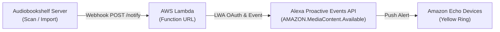
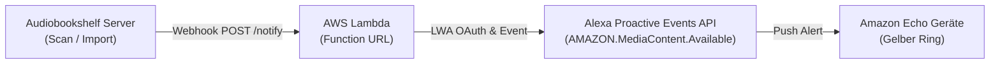

# 🔔 Proactive Notifications (New Library Items) / Benachrichtigungen

> 🇩🇪 **Deutsche Version weiter unten** — siehe [Deutsche Anleitung](#-deutsche-anleitung).

Documentation for setting up automatic notifications on Amazon Echo devices when new audiobooks or podcasts are added to your Audiobookshelf server.

---

# 🇺🇸 English

The Audiobookshelf Alexa Skill supports automatic notifications via the **Alexa Proactive Events API** (`AMAZON.MediaContent.Available`).

Whenever a new audiobook or podcast is added to your Audiobookshelf library, Alexa alerts your Echo devices:
- **Echo Speakers:** Yellow light ring pulses & notification chime sounds.
- **Echo Show / Spot:** Notification banner on the home screen.
- **Voice readout:** When asked *"Alexa, what are my notifications?"*, Alexa responds:  
  *"Bookshelf for Audiobookshelf: A new audiobook '[Title]' by [Author] is available in your library."*

---

## 🏗️ How It Works



1. **Audiobookshelf** discovers a newly imported item (e.g., following a folder scan).
2. The built-in **Apprise / Webhook** notification service in Audiobookshelf sends an HTTPS POST request to your Lambda Function URL (`/webhook` or `/notify`).
3. The Lambda function validates the request, converts the title and author into the `AMAZON.MediaContent.Available` schema, and dispatches the event via Amazon's Proactive Events API.
4. All users who granted notification permissions for the skill receive the alert on their Echo devices.

---

## ⚙️ Setup & Configuration

### 1. Retrieve Alexa Client ID & Client Secret
1. Open the [Alexa Developer Console](https://developer.amazon.com/alexa/console/ask).
2. Select your skill and navigate to **Build &rarr; Permissions**.
3. Scroll down to the bottom to the **Alexa Skill Messaging** section.
4. Copy:
   - **Client Id**
   - **Client Secret**

### 2. Set Lambda Environment Variables
In the AWS Lambda Console (Function `audiobookshelf-alexa` &rarr; *Configuration* &rarr; *Environment variables*):

| Variable | Description | Example / Default |
|---|---|---|
| `ALEXA_CLIENT_ID` | Client ID from Developer Console | `amzn1.application-oa2-client.xxx` |
| `ALEXA_CLIENT_SECRET` | Client Secret from Developer Console | `xxxxxxxx...` |
| `ALEXA_API_REGION` | API region for Amazon Proactive Events | `eu` *(Default)*, `na`, or `fe` |
| `ALEXA_SKILL_STAGE` | Skill stage | `development` *(during testing)* or `live` |
| `WEBHOOK_SECRET` | *(Optional)* Secret token for webhook security | e.g. `my-secure-token-123` |

### 3. Configure Audiobookshelf Webhook
1. Log into your Audiobookshelf Web UI as an Administrator.
2. Navigate to **Settings &rarr; Notifications** (*Einstellungen &rarr; Benachrichtigungen*).
3. Add a new notification:
   - **Type / Apprise URL:**  
     `https://<YOUR-LAMBDA-FUNCTION-URL>/webhook`  
     *(If `WEBHOOK_SECRET` is set: `https://<YOUR-LAMBDA-FUNCTION-URL>/webhook?secret=my-secure-token-123`)*
   - **Event:** `itemAdded` / *Item Added*
   - **Title Template:** `{{title}}`
   - **Body Template:** `{{author}}` (or leave empty)
4. Click **Save** and optionally click **Test**.

### 4. Enable Notifications in the Alexa App
Due to Amazon privacy policies, users must explicitly grant notification permissions for the skill:
1. Open the **Amazon Alexa App** on your smartphone.
2. Go to **More &rarr; Skills & Games &rarr; Your Skills**.
3. Select **Bookshelf for Audiobookshelf** (or **Bücherregal für Audiobookshelf**).
4. Tap **Settings &rarr; Permissions**.
5. Toggle on **Alexa Notifications**.

---

## 🧪 Manual Testing via cURL

You can test the webhook endpoint directly at any time:

```bash
curl -X POST "https://<YOUR-LAMBDA-FUNCTION-URL>/webhook" \
  -H "Content-Type: application/json" \
  -d '{"title": "The Hobbit", "author": "J.R.R. Tolkien", "contentType": "BOOK"}'
```

**Response (HTTP 200):**
```json
{
  "status": "success",
  "event": "AMAZON.MediaContent.Available",
  "referenceId": "urn:uuid:01234567-89ab-cdef-...",
  "content": {
    "title": "The Hobbit",
    "author": "J.R.R. Tolkien",
    "contentType": "BOOK"
  }
}
```

---
---

# 🇩🇪 Deutsche Anleitung

Der Audiobookshelf Alexa Skill unterstützt automatische Benachrichtigungen über die **Alexa Proactive Events API** (`AMAZON.MediaContent.Available`).

Sobald ein neues Hörbuch oder ein neuer Podcast zu deiner Audiobookshelf-Bibliothek hinzugefügt wird, benachrichtigt Alexa deine Echo-Geräte:
- **Echo Lautsprecher:** Gelber Leuchtring pulsiert & Benachrichtigungston.
- **Echo Show / Spot:** Benachrichtigungs-Banner auf dem Startbildschirm.
- **Sprachausgabe:** Auf die Frage *„Alexa, was sind meine Benachrichtigungen?“* antwortet Alexa:  
  *„Bücherregal für Audiobookshelf: Ein neues Hörbuch ‚[Titel]‘ von [Autor] ist in deiner Bibliothek verfügbar.“*

---

## 🏗️ Funktionsweise & Ablauf



1. **Audiobookshelf** stellt fest, dass ein neues Medium existiert (z. B. nach einem Ordner-Scan).
2. Der integrierte **Apprise / Webhook**-Dienst in Audiobookshelf sendet einen HTTPS POST-Request an die Lambda Function URL (`/webhook` oder `/notify`).
3. Die Lambda-Funktion validiert die Anfrage, wandelt den Titel und Autor in das Schema `AMAZON.MediaContent.Available` um und sendet das Event über Amazons Proactive Events API.
4. Alle Nutzer, die Benachrichtigungen für den Skill aktiviert haben, erhalten die Benachrichtigung auf ihren Geräten.

---

## ⚙️ Einrichtung

### 1. Alexa Client ID & Client Secret abrufen
1. Öffne die [Alexa Developer Console](https://developer.amazon.com/alexa/console/ask).
2. Wähle deinen Skill aus und gehe zu **Build &rarr; Permissions**.
3. Scrolle ganz nach unten zum Abschnitt **Alexa Skill Messaging** (oder **Skill Messaging**).
4. Kopiere:
   - **Client Id**
   - **Client Secret**

### 2. Lambda Umgebungsvariablen setzen
In der AWS Lambda Konsole (Funktion `audiobookshelf-alexa` &rarr; *Configuration* &rarr; *Environment variables*):

| Variable | Beschreibung | Beispiel / Standard |
|---|---|---|
| `ALEXA_CLIENT_ID` | Client ID aus der Developer Console | `amzn1.application-oa2-client.xxx` |
| `ALEXA_CLIENT_SECRET` | Client Secret aus der Developer Console | `xxxxxxxx...` |
| `ALEXA_API_REGION` | API-Region für Amazon Proactive Events | `eu` *(Standard)*, `na` oder `fe` |
| `ALEXA_SKILL_STAGE` | Skill-Stufe | `development` *(während Tests)* bzw. `live` |
| `WEBHOOK_SECRET` | *(Optional)* Geheimer Schlüssel zur Absicherung | z. B. `mein-geheimes-token-123` |

### 3. Audiobookshelf Webhook einrichten
1. Öffne deine Audiobookshelf Web-Oberfläche als Administrator.
2. Gehe zu **Einstellungen &rarr; Benachrichtigungen** (*Settings &rarr; Notifications*).
3. Füge eine neue Benachrichtigung hinzu:
   - **Typ / Apprise URL:**  
     `https://<DEINE-LAMBDA-FUNCTION-URL>/webhook`  
     *(Wenn `WEBHOOK_SECRET` gesetzt ist: `https://<DEINE-LAMBDA-FUNCTION-URL>/webhook?secret=mein-geheimes-token-123`)*
   - **Ereignis (Event):** `itemAdded` / *Item Added*
   - **Titel-Vorlage:** `{{title}}`
   - **Text-Vorlage:** `{{author}}` (oder leer lassen)
4. Klicke auf **Speichern** und optional auf **Test**.

### 4. Benachrichtigungen auf dem Echo aktivieren
Aufgrund der Amazon Datenschutz-Vorgaben muss der Nutzer Benachrichtigungen für den Skill einmalig erlauben:
1. Öffne die **Amazon Alexa App** auf dem Smartphone.
2. Gehe zu **Mehr &rarr; Skills und Spiele &rarr; Meine Skills**.
3. Wähle **Bücherregal für Audiobookshelf** aus.
4. Tippe auf **Einstellungen &rarr; Berechtigungen**.
5. Aktiviere den Schalter **Alexa-Benachrichtigungen**.

---

## 🧪 Manuelles Testen via cURL

Du kannst den Webhook jederzeit direkt testen:

```bash
curl -X POST "https://<DEINE-LAMBDA-FUNCTION-URL>/webhook" \
  -H "Content-Type: application/json" \
  -d '{"title": "Der Hobbit", "author": "J.R.R. Tolkien", "contentType": "BOOK"}'
```

**Antwort (HTTP 200):**
```json
{
  "status": "success",
  "event": "AMAZON.MediaContent.Available",
  "referenceId": "urn:uuid:01234567-89ab-cdef-...",
  "content": {
    "title": "Der Hobbit",
    "author": "J.R.R. Tolkien",
    "contentType": "BOOK"
  }
}
```
