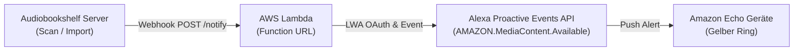

# 🔔 Proactive Notifications (Benachrichtigungen für neue Bibliotheks-Elemente)

Der Audiobookshelf Alexa Skill unterstützt automatische Benachrichtigungen über die **Alexa Proactive Events API** (`AMAZON.MediaContent.Available`).

Sobald ein neues Hörbuch oder ein neuer Podcast zu deiner Audiobookshelf-Bibliothek hinzugefügt wird, benachrichtigt Alexa deine Echo-Geräte:
- **Echo Lautsprecher:** Gelber Leuchtring pulsiert & Benachrichtigungston.
- **Echo Show / Spot:** Benachrichtigungs-Banner auf dem Startbildschirm.
- **Sprachausgabe:** Auf die Frage *„Alexa, was sind meine Benachrichtigungen?“* antwortet Alexa:  
  *„Bücherregal für Audiobookshelf: Ein neues Hörbuch ‚[Titel]‘ von [Autor] ist in deiner Bibliothek verfügbar.“*

---

## 🏗️ Funktionsweise & Ablauf



1. **Audiobookshelf** stellt fest, dass ein neues Medium existiert (z. B. nach einem Ordner-Scan).
2. Der integrierte **Apprise / Webhook**-Dienst in Audiobookshelf sendet einen HTTPS POST-Request an die Lambda Function URL (`/webhook` oder `/notify`).
3. Die Lambda-Funktion validiert die Anfrage, wandelt den Titel und Autor in das Schema `AMAZON.MediaContent.Available` um und sendet das Event über Amazons Proactive Events API.
4. Alle Nutzer, die Benachrichtigungen für den Skill aktiviert haben, erhalten die Benachrichtigung auf ihren Geräten.

---

## ⚙️ Einrichtung

### 1. Alexa Client ID & Client Secret abrufen
1. Öffne die [Alexa Developer Console](https://developer.amazon.com/alexa/console/ask).
2. Wähle deinen Skill aus und gehe zu **Build &rarr; Permissions**.
3. Scrolle ganz nach unten zum Abschnitt **Alexa Skill Messaging** (oder **Skill Messaging**).
4. Kopiere:
   - **Client Id**
   - **Client Secret**

### 2. Lambda Umgebungsvariablen setzen
In der AWS Lambda Konsole (Funktion `audiobookshelf-alexa` &rarr; *Configuration* &rarr; *Environment variables*):

| Variable | Beschreibung | Beispiel / Standard |
|---|---|---|
| `ALEXA_CLIENT_ID` | Client ID aus der Developer Console | `amzn1.application-oa2-client.xxx` |
| `ALEXA_CLIENT_SECRET` | Client Secret aus der Developer Console | `xxxxxxxx...` |
| `ALEXA_API_REGION` | API-Region für Amazon Proactive Events | `eu` *(Standard)* oder `na` |
| `ALEXA_SKILL_STAGE` | Skill-Stufe | `development` *(während Tests)* bzw. `live` |
| `WEBHOOK_SECRET` | *(Optional)* Geheimer Schlüssel zur Absicherung | z. B. `mein-geheimes-token-123` |

### 3. Audiobookshelf Webhook einrichten
1. Öffne deine Audiobookshelf Web-Oberfläche als Administrator.
2. Gehe zu **Einstellungen &rarr; Benachrichtigungen** (*Settings &rarr; Notifications*).
3. Füge eine neue Benachrichtigung hinzu:
   - **Typ / Apprise URL:**  
     `https://<DEINE-LAMBDA-FUNCTION-URL>/webhook`  
     *(Wenn `WEBHOOK_SECRET` gesetzt ist: `https://<DEINE-LAMBDA-FUNCTION-URL>/webhook?secret=mein-geheimes-token-123`)*
   - **Ereignis (Event):** `itemAdded` / *Item Added*
   - **Titel-Vorlage:** `{{title}}`
   - **Text-Vorlage:** `{{author}}` (oder leer lassen)
4. Klicke auf **Speichern** und optional auf **Test**.

### 4. Benachrichtigungen auf dem Echo aktivieren
Aufgrund der Amazon Datenschutz-Vorgaben muss der Nutzer Benachrichtigungen für den Skill einmalig erlauben:
1. Öffne die **Amazon Alexa App** auf dem Smartphone.
2. Gehe zu **Mehr &rarr; Skills und Spiele &rarr; Meine Skills**.
3. Wähle **Bücherregal für Audiobookshelf** aus.
4. Tippe auf **Einstellungen &rarr; Berechtigungen**.
5. Aktiviere den Schalter **Alexa-Benachrichtigungen**.

---

## 🧪 Manuelles Testen via cURL

Du kannst den Webhook jederzeit direkt testen:

```bash
curl -X POST "https://<DEINE-LAMBDA-FUNCTION-URL>/webhook" \
  -H "Content-Type: application/json" \
  -d '{"title": "Der Hobbit", "author": "J.R.R. Tolkien", "contentType": "BOOK"}'
```

**Antwort (HTTP 200):**
```json
{
  "status": "success",
  "event": "AMAZON.MediaContent.Available",
  "referenceId": "urn:uuid:01234567-89ab-cdef-...",
  "content": {
    "title": "Der Hobbit",
    "author": "J.R.R. Tolkien",
    "contentType": "BOOK"
  }
}
```
